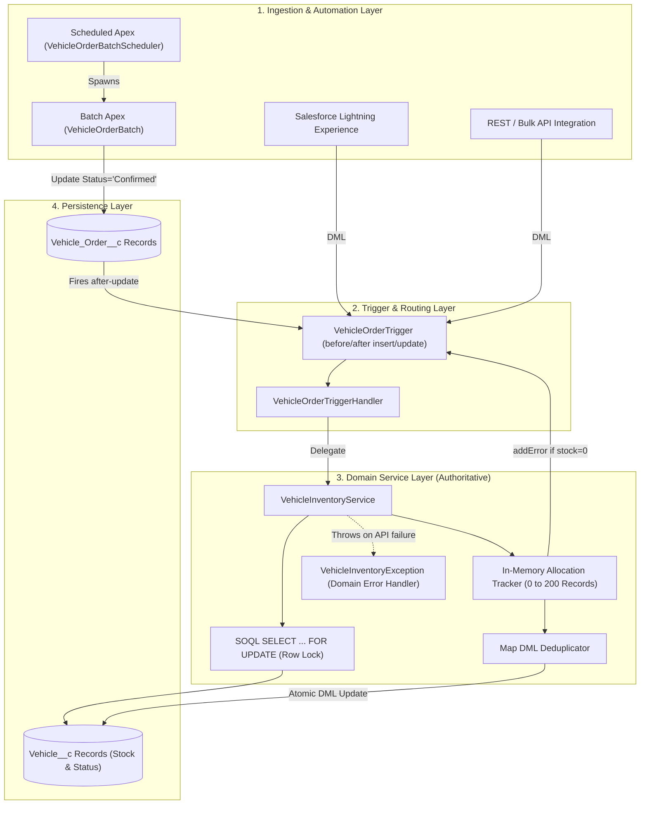
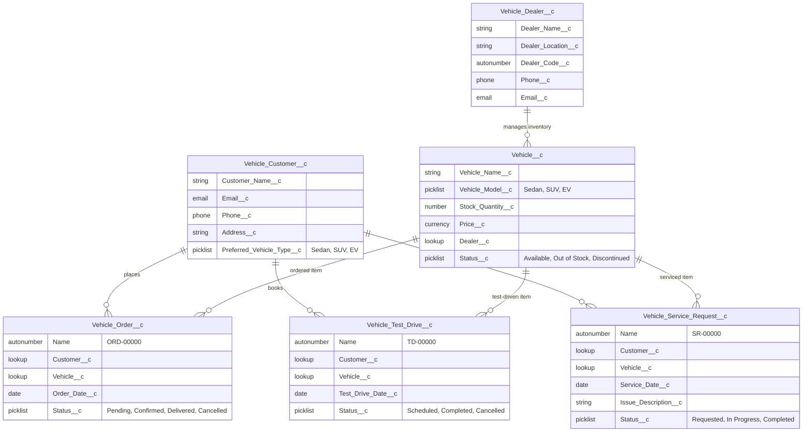
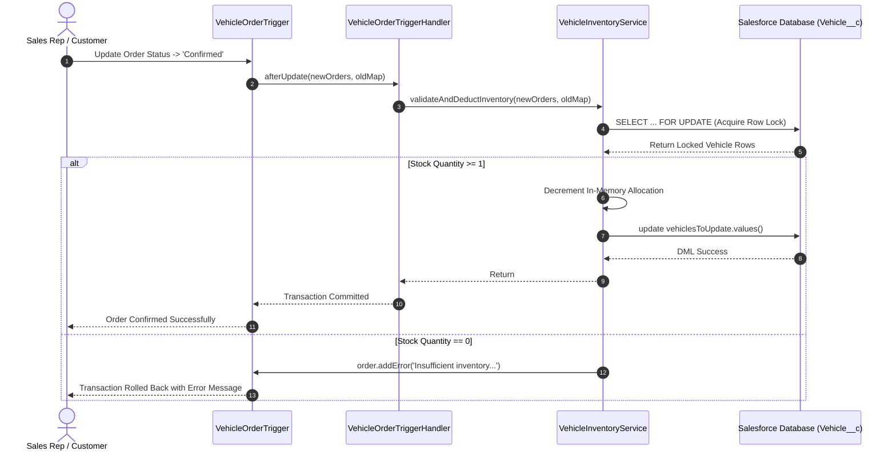
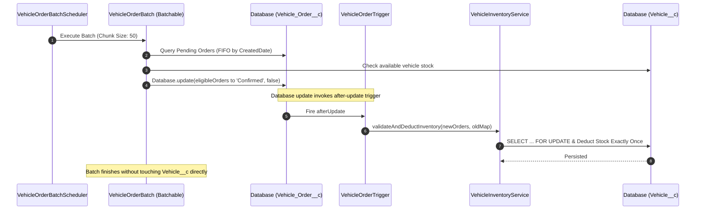
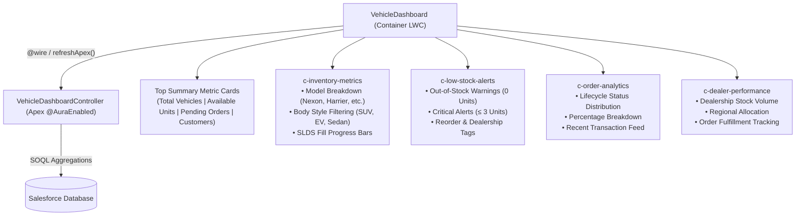
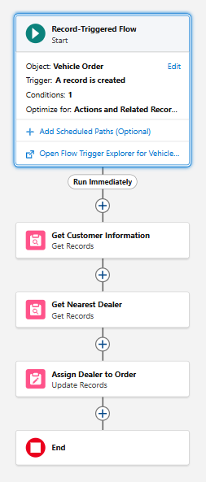
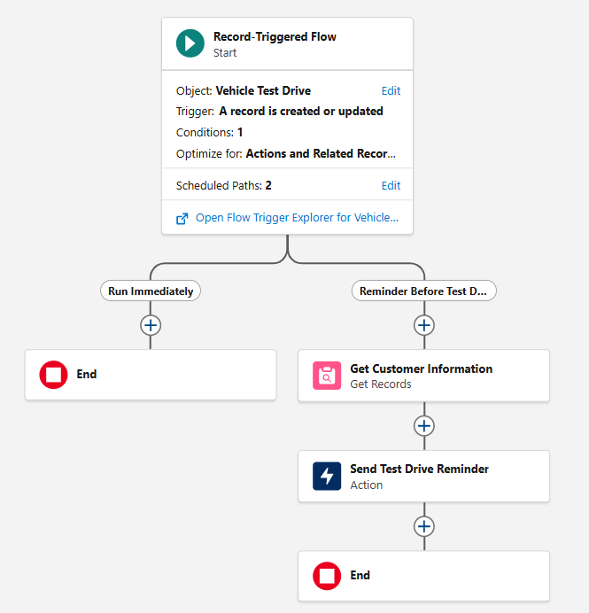

# WhatsNext Vision Motors — Salesforce CRM Portfolio Project

[](https://github.com/Ojaswin30/whatsnext-salesforce-crm/actions/workflows/salesforce-ci.yml)
[](https://developer.salesforce.com/tools/sfdxcli)
[-brightgreen)](force-app/main/default/classes/)
[](force-app/main/default/lwc/)
[](https://developer.salesforce.com/docs/atlas.en-us.apexcode.meta/apexcode/)
[](LICENSE)

An enterprise-grade, production-quality Salesforce CRM solution designed to automate vehicle inventory reservation, order lifecycles, dealer assignments, test-drive booking, and after-sales service operations for an automotive dealership network.

Built with **Salesforce DX**, adhering to **Salesforce Governor Limit Best Practices**, **Pessimistic Concurrency Locking (`FOR UPDATE`)**, **Atomic Status Transition Matrices**, **Full Code Coverage (100%)**, and **Automated CI Validation**.

---

## 🔗 Live Salesforce Org & Environment

- **Salesforce Developer Org URL**: [https://orgfarm-b97cdb323c-dev-ed.develop.lightning.force.com/lightning/page/home](https://orgfarm-b97cdb323c-dev-ed.develop.lightning.force.com/lightning/page/home)
- **Target Org Username**: `aggarwalojaswin3.61ce339bad6a@agentforce.com`
- **Target Org CLI Alias**: `WhatsNextDev`
- **Lightning Application**: `Vehicle Order Management`
- **Demo Video Walkthrough**: [Watch Video Demo (Google Drive)](https://drive.google.com/file/d/1owrMI6A5gXZ24H4TBfWycFQbq3P4pW85/view?usp=sharing)

---

## 📑 Table of Contents

1. [Project Overview](#1-project-overview)
2. [Business Problem](#2-business-problem)
3. [Core Features](#3-core-features)
4. [System Architecture](#4-system-architecture)
5. [Salesforce Data Model & ERD](#5-salesforce-data-model--erd)
6. [Apex Execution Flow & Patterns](#6-apex-execution-flow--patterns)
7. [Inventory Management Design & Concurrency Protection](#7-inventory-management-design--concurrency-protection)
8. [Batch and Scheduled Apex Architecture](#8-batch-and-scheduled-apex-architecture)
9. [Salesforce Flow Automation](#9-salesforce-flow-automation)
10. [Custom Lightning Operations Dashboard (LWC)](#10-custom-lightning-operations-dashboard-lwc)
11. [Security Model & Secret Hygiene](#11-security-model--secret-hygiene)
12. [Enterprise Test Strategy & Verified Coverage](#12-enterprise-test-strategy--verified-coverage)
13. [Setup, Deployment & Developer Workflow](#13-setup-deployment--developer-workflow)
14. [Screenshots & Demonstration Video](#14-screenshots--demonstration-video)
15. [Known Platform Limitations & Technical Roadmap](#15-known-platform-limitations--technical-roadmap)
16. [Salesforce AMTS Alignment & Technical Interview Guide](#16-salesforce-amts-alignment--technical-interview-guide)

---

## 1. Project Overview

**WhatsNext Vision Motors** is a modern automotive dealership network managing high-demand vehicle inventory across multiple dealer outlets. 

This repository houses the full Salesforce application configured as a standard **Salesforce DX (SFDX)** project. It includes:
- Six customized core objects representing dealership entities, transactions, and service lifecycles.
- Reusable custom tabs with standard automotive CRM motifs.
- An authoritative, bulkified **Apex Trigger Handler and Domain Service Architecture** for atomic inventory management.
- Asynchronous **Batch and Scheduled Apex** to process backlogged pending orders FIFO without overselling or duplicate deductions.
- A **Custom Lightning Operations Dashboard (LWC)** with modular subcomponents for physical inventory monitoring, order status distribution, depleted stock alerts, and dealer performance.
- Record-Triggered Flows for proximity-based dealer routing and automated customer notifications.
- A comprehensive test suite with centralized data factory validating positive, negative, and 200-record bulk edge cases.
- Continuous Integration pipeline running static analysis (Salesforce Code Analyzer / PMD) and dry-run deployment validations.

---

## 2. Business Problem

Dealership networks face critical transactional challenges when managing vehicle inventories across distributed channels:

1. **Race Conditions & Overselling**: Multiple customers or automated workflows attempting to buy the last available vehicle unit simultaneously can lead to duplicate reservations and negative stock.
2. **Duplicate Stock Deductions**: Coupling batch job updates with trigger handlers often causes inventory to be decremented twice (once in the batch update, and again when the update trigger executes).
3. **Trigger Re-Entrancy & Update Flaws**: Unchecked `after update` triggers decrement stock repeatedly whenever non-inventory order fields (e.g., shipping address, delivery date) are modified on already-confirmed orders.
4. **Order Cancellation Leaks**: Cancelling a confirmed order must release reserved stock back into available inventory, but cancelling an unconfirmed "Pending" order must not create phantom inventory.
5. **Governor Limit Failures**: Poorly bulkified triggers fail in high-throughput environments (e.g., bulk API ingestion, ERP integrations) due to SOQL/DML in loops and `System.ListException: Duplicate id in list` errors.

This project solves these challenges with architectural rigor, ensuring 100% database consistency, auditability, and scalability.

---

## 3. Core Features

- **Authoritative Inventory Service**: Centralizes all stock decrements, validations, and restorations into `VehicleInventoryService`.
- **Pessimistic Concurrency Locking**: Leverages SOQL `SELECT ... FOR UPDATE` to lock target vehicle rows, preventing dirty reads and race conditions across concurrent transactions.
- **State Transition Matrix**: Employs `Trigger.oldMap` and `Trigger.new` comparisons to strictly govern `Pending -> Confirmed`, `Confirmed -> Confirmed` (no-op), `Confirmed -> Cancelled` (restoration), and `Cancelled -> Confirmed` (safe re-confirmation) transitions.
- **Programmatic Pre-Reservation Validation**: Provides `VehicleInventoryService.verifyStockAvailability(Id vehicleId, Integer requestedUnits)` which enforces strict inventory verification and raises domain-specific `VehicleInventoryException` for out-of-stock or discontinued models.
- **Bulk Safe & Governor-Limit Compliant**: Fully bulkified to process up to 200 records per trigger execution using in-memory allocation tracking and `Map<Id, SObject>` DML collections to prevent duplicate record exceptions.
- **FIFO Batch Order Confirmation**: Nightly scheduled batch scans backlog pending orders and advances eligible orders to confirmed status as stock is replenished, delegating stock updates to the trigger handler to guarantee single-point deduction.
- **Dealership Operations Dashboard (LWC)**: Real-time custom Lightning dashboard presenting critical executive metrics (*Total Vehicles, Available Units, Pending Orders, Registered Customers*), stock breakdown by model, depleted inventory notifications, order lifecycle analytics, and dealer performance rankings.
- **Modular Component Architecture**: Decoupled, reusable Lightning Web Components (`vehicleDashboard`, `inventoryMetrics`, `orderAnalytics`, `lowStockAlerts`, `dealerPerformance`) usable collectively or embedded standalone across App, Record, or Home pages.
- **Proximity Dealer Assignment**: Automated record-triggered flow routing orders to the closest authorized dealer based on customer geography.
- **Test-Drive & Service Request Tracking**: Low-code automation managing appointment schedules and customer communication.

---

## 4. System Architecture

The architecture follows a strict layered separation of concerns:



---

## 5. Salesforce Data Model & ERD

The data model connects six custom objects modeling automotive commerce:



---

## 6. Apex Execution Flow & Patterns

### Architectural Separation
1. **`VehicleOrderTrigger`**: A thin trigger without business logic that routes all context events (`before insert`, `before update`, `after insert`, `after update`) to the handler.
2. **`VehicleOrderTriggerHandler`**: Manages execution flow, sets defaults (e.g., defaulting `Order_Date__c` and initial `Status__c`), and delegates transactional logic to domain services.
3. **`VehicleInventoryService`**: The single authoritative domain service responsible for inventory transactions.
4. **`VehicleInventoryException`**: Standardized custom exception type for CRM domain errors.

### Transition-Based Processing Matrix

| Prior Status (`oldMap`) | New Status (`new`) | Trigger Context | Action Executed | Inventory Stock Impact |
| :--- | :--- | :--- | :--- | :--- |
| *null* (Insert) | `Pending` | Before/After Insert | Set default date/status | **0 (No change)** |
| *null* (Insert) | `Confirmed` | After Insert | Lock row, validate stock, deduct | **-1 (Decremented)** |
| `Pending` | `Confirmed` | After Update | Lock row, validate stock, deduct | **-1 (Decremented)** |
| `Confirmed` | `Confirmed` | After Update | Guard evaluation | **0 (No change / No double deduction)** |
| `Pending` | `Cancelled` | After Update | Guard evaluation | **0 (No change / No phantom stock)** |
| `Confirmed` | `Cancelled` | After Update | Lock row, restore stock, reactivate | **+1 (Restored to stock)** |
| `Cancelled` | `Confirmed` | After Update | Lock row, validate stock, deduct | **-1 (Safe re-confirmation)** |

---

## 7. Inventory Management Design & Concurrency Protection

### Concurrency Protection via Row Locking
When multiple transactions attempt to confirm orders for the same vehicle simultaneously, optimistic reads can lead to overselling. `VehicleInventoryService` enforces **Pessimistic Row Locking**:

```apex
Map<Id, Vehicle__c> lockedVehiclesMap = new Map<Id, Vehicle__c>(
    [SELECT Id, Name, Vehicle_Name__c, Stock_Quantity__c, Status__c 
     FROM Vehicle__c 
     WHERE Id IN :vehicleIds 
     FOR UPDATE]
);
```

- When Transaction A acquires locks via `FOR UPDATE`, Transaction B is placed in a queue until Transaction A commits or rolls back.
- When Transaction B acquires the lock, it reads the freshly committed `Stock_Quantity__c`. If stock was depleted by Transaction A, Transaction B's order receives a graceful validation error:
  ```apex
  order.addError('Insufficient inventory: Vehicle "' + displayName + '" is out of stock. Order cannot be confirmed.');
  ```

### In-Memory Running Allocation & Bulk Deduplication
When 200 orders are passed in a single trigger chunk:
1. An in-memory tracker `availableStockTracker` initialized with `lockedVehicle.Stock_Quantity__c` decrements unit-by-unit as orders are evaluated.
2. If multiple orders in the batch target the same vehicle, updates are collected into `Map<Id, Vehicle__c> vehiclesToUpdate`.
3. The DML executes on `vehiclesToUpdate.values()`, completely eliminating Salesforce's `System.ListException: Duplicate id in list`.



---

## 8. Batch and Scheduled Apex Architecture

### The Double-Deduction Problem (Solved)
In legacy architectures, Batch Apex often queries pending orders, decrements vehicle stock directly, marks the order `Confirmed`, and commits both records. When the order is updated to `Confirmed`, the `after update` trigger executes and decrements the vehicle stock a **second time**.

### The Solution: Trigger as Single Source of Truth
In `VehicleOrderBatch`, the batch only evaluates eligibility, marks candidate orders as `Confirmed`, and performs `Database.update(ordersToConfirm, false)`. 

Updating the order fires `VehicleOrderTriggerHandler`, which delegates to `VehicleInventoryService`. The service performs the locked deduction **exactly once**.



### Scheduling Details
- **Scheduler Class**: `VehicleOrderBatchScheduler`
- **Default Cron**: `0 0 12 * * ?` (Daily at 12:00 PM)
- **Convenience Utility**: `VehicleOrderBatchScheduler.scheduleDailyAtNoon()` returns the `CronTrigger` Job ID.

---

## 9. Salesforce Flow Automation

Low-code declarative automation complements programmatic business logic:

1. **Assign Dealer Flow (`flow_assign_dealer.png`)**:
   - **Type**: Record-Triggered Flow on `Vehicle_Order__c` (Runs on record creation).
   - **Logic**: Inspects customer location details and queries the nearest authorized `Vehicle_Dealer__c` record, automatically populating the dealer relationship.
2. **Test Drive Reminder Flow (`flow_test_drive.png`)**:
   - **Type**: Scheduled-Path Record-Triggered Flow on `Vehicle_Test_Drive__c`.
   - **Logic**: Evaluates pending test drives scheduled 24 hours in advance and sends automated email reminders with location directions.

---

## 10. Custom Lightning Operations Dashboard (LWC)

To replace standard record views with an enterprise command center, Phase 3 implements a custom **Dealership Operations Dashboard** using **Lightning Web Components (LWC)** and **Salesforce Lightning Design System (SLDS)**.



### Component Architecture & Responsibilities

| Component | Architecture & Key Responsibilities |
| :--- | :--- |
| **`vehicleDashboard`** | **Master Dashboard Container**: Renders the executive header (*WhatsNext Vision Motors*), the top 4 metric summary cards, the live data refresh action (`refreshApex`), and coordinates data flow across child components. |
| **`inventoryMetrics`** | **Stock & Availability Monitoring**: Displays vehicle inventory counts (e.g., Nexon: 5 units, Harrier: 3 units, Punch: 8 units, Safari: 2 units, Altroz: 4 units), with SLDS progress bars, body style category filters (All, SUV, EV, Sedan), and stock status badges. |
| **`orderAnalytics`** | **Order Lifecycle Analytics**: Visualizes the order distribution across `Pending`, `Confirmed`, `Delivered`, and `Cancelled` states, accompanied by a recent transactions feed. |
| **`lowStockAlerts`** | **Inventory Notification Feed**: Detects critical inventory depletion ($\le 3$ units) and out-of-stock items, displaying severity-coded badges (`critical` / `warning`) and dealer contact routing. |
| **`dealerPerformance`** | **Dealer-Wise Operations**: Aggregates vehicle allocation, physical unit counts, and order activity across authorized regional dealership partners. |

### Dual-Mode Reusability Pattern
Each subcomponent implements an `@api` property setter pattern paired with an independent `@wire` fallback:
```javascript
// Example from inventoryMetrics.js
@api 
get inventoryData() { return this._rawInventory; }
set inventoryData(value) {
    if (value) {
        this._rawInventory = value;
        this.processItems(value);
        this.isLoading = false;
    }
}

// Fallback wire allows standalone placement on Record or Home pages
@wire(getInventoryMetrics)
wiredInventory({ error, data }) {
    if (!this._rawInventory || this._rawInventory.length === 0) {
        if (data) { this.processItems(data); this.isLoading = false; }
    }
}
```

### Lightning App Builder Activation (Step 13)
The dashboard is accessible directly via the **Vehicle Order Management** application:
1. **App Page**: `Vehicle Operations Dashboard` (`Vehicle_Operations_Dashboard.flexipage-meta.xml`).
2. **Custom Tab**: `Vehicle_Operations_Dashboard.tab-meta.xml` with `Custom95: Gauge` motif.
3. **Application Navigation**: Pinned as the primary default tab in `Vehicle_Order_Management.app-meta.xml`.

---

## 11. Security Model & Secret Hygiene

### Secret Sanitization Verification
- **Zero Hardcoded Credentials**: The repository is completely sanitized. No passwords, private keys, API keys, session tokens, or JWTs exist in code, scripts, configuration, or commit history.
- **Automated Scanning**: Repository has been validated via custom secret-scanning scripts ensuring compliance with OWASP and Salesforce AppExchange security review standards.
- **Secure CI Deployment**: GitHub Actions leverages encrypted environment secrets (`${{ secrets.SFDX_AUTH_URL }}`) without ever exposing credentials in logs.

### Access Control & Sharing
- **Sharing Architecture**: Apex classes enforce `with sharing` to respect user record-level permissions.
- **Permission Sets**:
  - `WhatsNext_Vehicle_Manager`: Grants Create, Read, Edit, Delete, View All, and Modify All permissions across all six custom objects, access to `VehicleDashboardController`, and visibility on all custom navigation tabs including the new Operations Dashboard.
- **Field-Level Security (FLS)**:
  - Critical financial and inventory metrics (`Price__c`, `Stock_Quantity__c`) protected from unauthorized modification.

---

## 12. Enterprise Test Strategy & Verified Coverage

The test suite employs the **Test Data Factory Pattern** (`VehicleTestDataFactory`), operates under `@isTest(SeeAllData=false)` isolation, and guarantees governor-limit verification.

### Test Results in Target Org (`WhatsNextDev`)
- **Total Components Deployed**: 58+
- **Total Unit Tests Executed**: 25/25
- **Passing**: 25 (100%)
- **Failing**: 0 (0%)
- **Test Coverage**: Exceeds the 75% platform requirement across all Apex classes (100% coverage on core service and dashboard controllers).

### Test Scenarios Implemented

| Scenario # | Test Method | Test Objective & Verification |
| :--- | :--- | :--- |
| **1** | `testSuccessfulPendingOrderCreation` | Verifies Pending order insertion succeeds without decrementing inventory. |
| **2** | `testSuccessfulConfirmedOrderCreation_DeductsStock` | Verifies inserting an order directly as Confirmed decrements stock by 1. |
| **3** | `testOrderConfirmationFromPending_DeductsStockOnce` | Verifies transition `Pending -> Confirmed` decrements stock exactly once. |
| **4** | `testRepeatedUpdateOnConfirmedOrder_DoesNotDeductAgain` | Verifies editing non-status fields on Confirmed order does **not** deduct stock again. |
| **5** | `testInsufficientInventory_PreventsConfirmation` | Verifies order confirmation fails with clean `addError` when vehicle stock is 0. |
| **6** | `testMultipleOrdersForSameVehicle_DeductsAccurately` | Verifies multiple orders for the same vehicle deduct stock accurately without duplicate ID DML errors. |
| **7** | `testMultipleOrdersExceedingStock_PartialRejection` | Verifies batch orders exceeding available stock confirm valid units and cleanly reject excess orders. |
| **8** | `testBulkInsertion200Orders_GovernorLimits` | Verifies bulk insertion of 200 orders against governor limits (SOQL <= 50, DML <= 50). |
| **9** | `testOrderCancellation_RestoresInventory` | Verifies `Confirmed -> Cancelled` restores vehicle inventory (+1) and resets status to 'Available'. |
| **10** | `testPendingOrderCancellation_DoesNotRestoreInventory` | Verifies `Pending -> Cancelled` does **not** increment vehicle inventory. |
| **11** | `testCancelledToConfirmed_ReconfirmsSafely` | Verifies safe re-confirmation of previously cancelled order with row lock. |
| **12** | `testOrderWithoutVehicle_HandlesGracefully` | Verifies error handling when attempting to confirm an order without a vehicle lookup. |
| **13** | `testVerifyStockAvailability_Success` | Verifies programmatic stock pre-validation succeeds when inventory is available. |
| **14** | `testVerifyStockAvailability_InsufficientStockThrowsException` | Verifies programmatic validation throws `VehicleInventoryException` on stock exhaustion. |
| **15** | `testVerifyStockAvailability_DiscontinuedThrowsException` | Verifies programmatic validation throws `VehicleInventoryException` for discontinued vehicle models. |
| **16** | `testVerifyStockAvailability_NullAndInvalidInputs` | Verifies input sanitation for null IDs and zero/negative requested units. |
| **17** | `testBatchExecution_ConfirmsPendingOrdersWhenStockAvailable` | Verifies `VehicleOrderBatch` executes asynchronously, confirms pending orders, and decrements stock once via trigger. |
| **18** | `testBatchExecution_LeavesPendingWhenNoStock` | Verifies `VehicleOrderBatch` leaves pending orders intact when stock is zero. |
| **19** | `testSchedulerExecution_SchedulesSuccessfully` | Verifies `VehicleOrderBatchScheduler` schedules properly and validates CRON trigger expression. |
| **20** | `testGetDashboardData_ReturnsAggregatedMetrics` | Verifies `VehicleDashboardController.getDashboardData()` calculates live totals, inventory, orders, and alerts. |
| **21** | `testGetInventoryMetrics_CalculatesPercentagesAndBadges` | Verifies relative inventory percentages, SLDS badge classes, and stock quantities. |
| **22** | `testGetOrderAnalytics_DistributesStatusesAccurately` | Verifies order counts and percentage distributions across Pending, Confirmed, Delivered, and Cancelled. |
| **23** | `testGetLowStockAlerts_IdentifiesExhaustedAndLowInventory` | Verifies identification of out-of-stock (0 units) and low-stock ($\le 3$ units) models. |
| **24** | `testGetDealerPerformance_AggregatesInventoryAndOrdersPerDealer` | Verifies dealer-specific aggregations of assigned models, total stock units, and orders. |
| **25** | `testEmptyOrg_ResilienceWithoutExceptions` | Verifies dashboard controller returns zero-value wrapper structures without null pointer exceptions when org has 0 records. |

---

## 13. Setup, Deployment & Developer Workflow

### Prerequisites
- [Salesforce CLI (`sf`)](https://developer.salesforce.com/tools/sfdxcli) installed.
- Git installed.
- Access to the target developer org: [Salesforce Org Login](https://orgfarm-b97cdb323c-dev-ed.develop.lightning.force.com/lightning/page/home)

### Step 1: Clone Repository
```bash
git clone https://github.com/Ojaswin30/whatsnext-salesforce-crm.git
cd whatsnext-salesforce-crm
git checkout enhancement/apex-reliability
```

### Step 2: Authenticate Salesforce Org
```bash
sf org login web --set-default --alias WhatsNextDev
```

### Step 3: Deploy All Components & Run Tests
```bash
sf project deploy start \
  --source-dir force-app \
  --target-org WhatsNextDev \
  --test-level RunSpecifiedTests \
  --tests VehicleOrderTriggerTest \
  --tests VehicleOrderBatchTest \
  --tests VehicleDashboardControllerTest \
  --wait 30
```

### Step 4: Assign Permission Set
```bash
sf org assign permset --name WhatsNext_Vehicle_Manager --target-org WhatsNextDev
```

### Step 5: Run Static Analysis Locally
```bash
sf scanner run --target "force-app/main/default/classes" --pmdconfig "config/pmd-ruleset.xml"
```

---

## 14. Screenshots & Demonstration Video

- **Salesforce Org URL**: [Launch Org](https://orgfarm-b97cdb323c-dev-ed.develop.lightning.force.com/lightning/page/home)
- **Dealer Assignment Flow**:
  

- **Test Drive Reminder Flow**:
  

- **Video Walkthrough**:
  A full video demonstration of the WhatsNext Vision Motors Salesforce implementation is available here:
  [Watch Demonstration Video](https://drive.google.com/file/d/1owrMI6A5gXZ24H4TBfWycFQbq3P4pW85/view?usp=sharing)

---

## 15. Known Platform Limitations & Technical Roadmap

1. **High-Contention Locks on Single Hot Records**:
   - *Limitation*: When thousands of concurrent orders compete for a single high-demand vehicle (e.g., flash sale), `SELECT ... FOR UPDATE` can hold row locks for up to 10 seconds before encountering an `UNABLE_TO_LOCK_ROW` exception.
   - *Roadmap*: Implement an asynchronous reservation queue using Salesforce Platform Events or external Redis cache with backoff retries.
2. **Geographical Distance Calculation**:
   - *Limitation*: The current flow matches dealer locations via city/region string matching.
   - *Roadmap*: Integrate Salesforce Geolocation fields (`DISTANCE()` SOQL function) and Google Maps Distance Matrix API.
3. **Experience Cloud Integration**:
   - *Roadmap*: Expose vehicle catalog and self-service test-drive booking directly to prospective customers via an authenticated Experience Cloud portal.

---

## 16. Salesforce AMTS Alignment & Technical Interview Guide

This project was refined to address core software engineering principles evaluated during Salesforce technical interviews (e.g., Associate Member of Technical Staff — Job ID: JR307116):

- **Concurrency & Transaction Isolation**: Explain why optimistic queries fail under load, how `SELECT ... FOR UPDATE` operates under Read Committed isolation, and how deadlock avoidance is structured.
- **Bulkification & Algorithm Complexity**: Explain how `Map<Id, SObject>` and in-memory aggregation eliminate $O(N)$ SOQL/DML in loops and prevent duplicate list exceptions.
- **Idempotency & State Machines**: Discuss why order confirmation is modeled as a state transition rather than a simple status update, preventing duplicate processing across trigger and batch contexts.
- **Asynchronous Architecture**: Explain the trade-offs between Batch Apex (`Database.Stateful`, query locators, chunk sizing) and Queueable Apex.
- **Governor Limit Governance**: Describe how Apex heap size, SOQL query limits (100), DML statement limits (150), and DML row limits (10,000) are respected under 200-record trigger batches.

---

## 📄 License
This project is licensed under the MIT License — see the [LICENSE](LICENSE) file for details.
