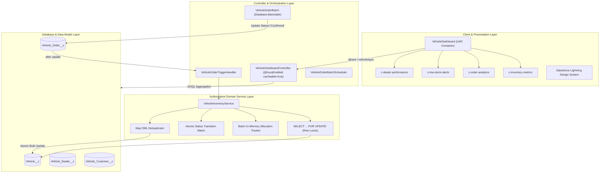

# WhatsNext Vision Motors — Technical Architecture & Engineering Decisions

## Executive Overview
**WhatsNext Vision Motors** is an enterprise-grade Salesforce CRM implementation designed to solve high-concurrency inventory reservation and lifecycle order management across a distributed automotive dealership network.

---

## 1. Architectural Layers & Separation of Concerns



---

## 2. Concurrency Control & Pessimistic Row Locking

### The Business Challenge
In high-demand vehicle retail (flash bookings, model launches), multiple concurrent transactions (API orders, sales reps in Lightning UI, nightly batch confirmation) compete for finite physical inventory units.

### The Problem with Optimistic Read-Check-Write
Standard SOQL read followed by condition checking is susceptible to race conditions:
```text
Thread A: SELECT Stock_Quantity__c (returns 1)
Thread B: SELECT Stock_Quantity__c (returns 1)
Thread A: Decrements to 0, saves.
Thread B: Decrements to -1 (Overselling / Phantom Inventory!).
```

### The Engineering Solution: `SELECT ... FOR UPDATE`
All inventory evaluations in `VehicleInventoryService` acquire exclusive row-level database locks:
```apex
Map<Id, Vehicle__c> lockedVehiclesMap = new Map<Id, Vehicle__c>(
    [SELECT Id, Name, Vehicle_Name__c, Stock_Quantity__c, Status__c 
     FROM Vehicle__c 
     WHERE Id IN :vehicleIds 
     FOR UPDATE]
);
```
- **Transaction Isolation**: Salesforce locks these rows under **Read Committed** with exclusive update intent until the transaction completes.
- **Race Condition Immunity**: Any concurrent thread attempting to lock the same vehicle is serialized, guaranteeing that stock can never drop below zero.

---

## 3. Atomic State Transition Matrix

To prevent trigger recursion, duplicate deductions, and inventory leaks, status changes are evaluated as formal state machine transitions:

| From Status | To Status | Action Executed | Business Rationale |
| :--- | :--- | :--- | :--- |
| **New (Insert)** | `Confirmed` | Deduct Stock (-1) | Direct confirmed booking from API/UI with stock reserved immediately. |
| **Pending** | `Confirmed` | Deduct Stock (-1) | Order approved or confirmed via Batch Apex; stock is locked and deducted. |
| **Confirmed** | `Confirmed` | **NO-OP (0)** | Field updates (e.g. delivery date, customer notes) **must not** decrement stock again. |
| **Confirmed** | `Cancelled` | Restore Stock (+1) | Released reservation returns unit to available physical inventory. |
| **Pending** | `Cancelled` | **NO-OP (0)** | Stock was never allocated; cancelling unconfirmed orders must not create phantom stock. |
| **Cancelled** | `Confirmed` | Deduct Stock (-1) | Re-instated order re-locks vehicle and verifies stock availability. |

```apex
// Safe Transition Guard in VehicleInventoryService
Boolean isConfirmed = isConfirmedStatus(newOrder.Status__c);
Boolean wasConfirmed = (oldOrdersMap != null && oldOrdersMap.containsKey(newOrder.Id))
    ? isConfirmedStatus(oldOrdersMap.get(newOrder.Id).Status__c)
    : false;

if (isConfirmed && !wasConfirmed) {
    qualifyingOrders.add(newOrder);
    vehicleIds.add(newOrder.Vehicle__c);
}
```

---

## 4. Bulkification & In-Memory Allocation Tracking

### Avoiding `System.ListException: Duplicate id in list`
When a bulk payload contains 200 orders referencing only 5 unique vehicle models, adding multiple instances of the same `Vehicle__c` to a `List<Vehicle__c>` results in runtime DML exceptions.

### The Solution:
`VehicleInventoryService` uses a localized memory allocation tracker and a `Map<Id, Vehicle__c>` DML buffer:
```apex
Map<Id, Decimal> availableStockTracker = new Map<Id, Decimal>();
for (Id vId : lockedVehiclesMap.keySet()) {
    availableStockTracker.put(vId, lockedVehiclesMap.get(vId).Stock_Quantity__c);
}

for (Vehicle_Order__c order : qualifyingOrders) {
    Decimal currentStock = availableStockTracker.get(order.Vehicle__c);
    if (currentStock != null && currentStock >= 1) {
        availableStockTracker.put(order.Vehicle__c, currentStock - 1);
        ordersToConfirm.add(order);
    } else {
        order.addError('Insufficient inventory: Vehicle is out of stock.');
    }
}

// Single deduplicated DML update
Map<Id, Vehicle__c> vehiclesToUpdate = new Map<Id, Vehicle__c>();
for (Id vId : availableStockTracker.keySet()) {
    Vehicle__c lockedVehicle = lockedVehiclesMap.get(vId);
    if (availableStockTracker.get(vId) != lockedVehicle.Stock_Quantity__c) {
        lockedVehicle.Stock_Quantity__c = availableStockTracker.get(vId);
        vehiclesToUpdate.put(vId, lockedVehicle);
    }
}
update vehiclesToUpdate.values();
```

---

## 5. Batch Apex Delegation Architecture

### Single-Point-of-Truth Principle
In many naive Salesforce implementations, Batch Apex directly queries orders, calculates vehicle stock, and updates both `Vehicle_Order__c` and `Vehicle__c`. When triggers are enabled, this causes stock to be decremented **twice**.

### The Solution:
`VehicleOrderBatch` delegates 100% of inventory logic to `VehicleInventoryService` via the trigger:
1. `VehicleOrderBatch` queries only `Vehicle_Order__c` records where `Status__c = 'Pending'`.
2. It sets `order.Status__c = 'Confirmed'`.
3. Executing `Database.update(qualifyingOrders, false)` fires the `VehicleOrderTrigger`.
4. The trigger acquires pessimistic row locks, validates real-time stock, decrements inventory atomically, and marks any out-of-stock orders with errors without failing the entire batch chunk.

---

## 6. Lightning Web Components Reactive Design

The frontend follows modern reactive architecture:
* **Single Wire Aggregation**: `vehicleDashboard` invokes `VehicleDashboardController.getDashboardData()` cached client-side via `@wire`.
* **Zero Lag Refresh**: `refreshApex()` clears the cache and refreshes all metric cards and child components simultaneously upon user action.
* **Component Encapsulation**: Each subcomponent (`inventoryMetrics`, `orderAnalytics`, `lowStockAlerts`, `dealerPerformance`) is decoupled with an `@api` property setter pattern and a fallback `@wire` service, enabling individual placement in Lightning App Builder.
