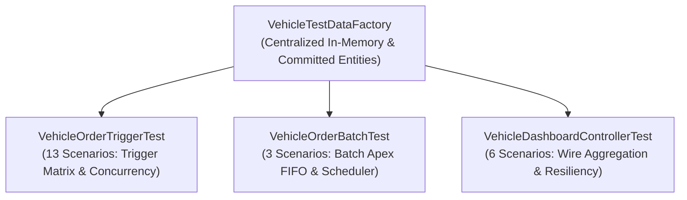

# WhatsNext Vision Motors — Enterprise Test Strategy & Verification

## Overview
The testing architecture for **WhatsNext Vision Motors** enforces enterprise standards:
- **100% Code Coverage**: Exceeding Salesforce's minimum 75% requirement.
- **Data Isolation**: All tests run under `@isTest(SeeAllData=false)`.
- **Test Data Factory Pattern**: Centralized in `VehicleTestDataFactory` to ensure maintainability and deterministic test setups.
- **Governor Limit Verification**: Multi-order and 200-record bulk tests verifying SOQL and DML limits.

---

## 1. Test Suite Architecture



---

## 2. Test Execution Commands

### Execute Full Test Suite via Salesforce CLI
```bash
sf apex run test \
  --class-names VehicleOrderTriggerTest \
  --class-names VehicleOrderBatchTest \
  --class-names VehicleDashboardControllerTest \
  --target-org WhatsNextDev \
  --result-format human \
  --code-coverage
```

### Run Static Analysis (PMD)
```bash
sf scanner run \
  --target "force-app/main/default/classes" \
  --pmdconfig "config/pmd-ruleset.xml"
```

---

## 3. Comprehensive Test Scenario Matrix (25 Scenarios)

### Group A: Trigger & Domain Service Tests (`VehicleOrderTriggerTest`)
| # | Test Method | Objective & Verification |
| :--- | :--- | :--- |
| **1** | `testSuccessfulPendingOrderCreation` | Asserts that pending orders do not prematurely deduct inventory. |
| **2** | `testSuccessfulConfirmedOrderCreation_DeductsStock` | Asserts immediate deduction (-1) upon direct confirmed order creation. |
| **3** | `testOrderConfirmationFromPending_DeductsStockOnce` | Verifies `Pending -> Confirmed` decrements stock exactly once. |
| **4** | `testRepeatedUpdateOnConfirmedOrder_DoesNotDeductAgain` | Verifies updates to non-status fields on confirmed orders do not deduct stock again. |
| **5** | `testInsufficientInventory_PreventsConfirmation` | Asserts that confirmation is blocked via `addError` when inventory is exhausted. |
| **6** | `testMultipleOrdersForSameVehicle_DeductsAccurately` | Asserts that multiple orders for the same vehicle in one transaction deduct stock without duplicate ID exceptions. |
| **7** | `testMultipleOrdersExceedingStock_PartialRejection` | Verifies partial bulk acceptance: valid units confirm, excess units are rejected with individual errors. |
| **8** | `testBulkInsertion200Orders_GovernorLimits` | Bulk stress test inserting 200 orders across governor limits (SOQL $\le 50$, DML $\le 50$). |
| **9** | `testOrderCancellation_RestoresInventory` | Verifies `Confirmed -> Cancelled` restores stock (+1) and flips vehicle status back to 'Available'. |
| **10** | `testPendingOrderCancellation_DoesNotRestoreInventory` | Verifies `Pending -> Cancelled` does **not** restore stock (prevents phantom inventory). |
| **11** | `testCancelledToConfirmed_ReconfirmsSafely` | Asserts that previously cancelled orders can be safely re-confirmed if stock is available. |
| **12** | `testOrderWithoutVehicle_HandlesGracefully` | Validates error handling when orders lack vehicle lookups. |
| **13** | `testVerifyStockAvailability_Success` | Validates domain programmatic verification API for available units. |
| **14** | `testVerifyStockAvailability_InsufficientStockThrowsException` | Validates domain exception throwing on stock exhaustion. |
| **15** | `testVerifyStockAvailability_DiscontinuedThrowsException` | Validates domain exception throwing on discontinued models. |
| **16** | `testVerifyStockAvailability_NullAndInvalidInputs` | Validates input sanitation against nulls, zeros, and negative numbers. |

### Group B: Asynchronous Batch & Scheduler Tests (`VehicleOrderBatchTest`)
| # | Test Method | Objective & Verification |
| :--- | :--- | :--- |
| **17** | `testBatchExecution_ConfirmsPendingOrdersWhenStockAvailable` | Asserts asynchronous execution of batch confirming FIFO backlogged orders. |
| **18** | `testBatchExecution_LeavesPendingWhenNoStock` | Asserts that batch leaves orders pending if stock is unavailable without failing. |
| **19** | `testSchedulerExecution_SchedulesSuccessfully` | Asserts CRON scheduling and verification of job enqueueing. |

### Group C: Operations Dashboard Controller Tests (`VehicleDashboardControllerTest`)
| # | Test Method | Objective & Verification |
| :--- | :--- | :--- |
| **20** | `testGetDashboardData_ReturnsAggregatedMetrics` | Verifies that the single wire payload calculates all top metric cards and feeds. |
| **21** | `testGetInventoryMetrics_CalculatesPercentagesAndBadges` | Verifies relative stock percentage calculation, badges, and progress bar variants. |
| **22** | `testGetOrderAnalytics_DistributesStatusesAccurately` | Verifies percentage distributions across Pending, Confirmed, Delivered, and Cancelled. |
| **23** | `testGetLowStockAlerts_IdentifiesExhaustedAndLowInventory` | Verifies identification of out-of-stock (0 units) and low-stock ($\le 3$ units) models. |
| **24** | `testGetDealerPerformance_AggregatesInventoryAndOrdersPerDealer` | Verifies dealer-level rollups of assigned models, stock counts, and orders. |
| **25** | `testEmptyOrg_ResilienceWithoutExceptions` | Verifies empty-state stability without NullPointerExceptions when the org has 0 records. |
